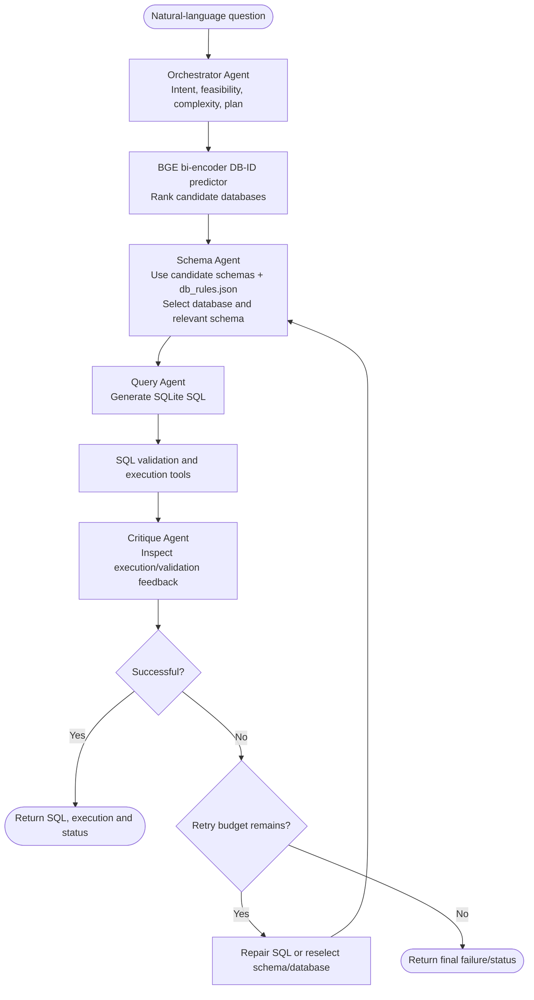

# MANToS — Multi-Agent Natural Language to SQL

**Source-code submission | Google Colab | Spider benchmark**

MANToS takes a natural-language question and produces SQL for a selected Spider database. The supplied inference notebook runs the full pipeline: orchestration, DB-ID retrieval, schema selection, SQL generation, validation/execution, critique, and bounded repair/reselection. The DB-ID retrieval model is a **Sentence-Transformer bi-encoder based on `BAAI/bge-base-en-v1.5`**. It is **not RoBERTa**.

> **Professor quick start:** Start with `notebooks/02_MANToS_Inference_and_Evaluation.ipynb`. The training notebook is `notebooks/01_DB_ID_BiEncoder_Training.ipynb`. Training is optional if a compatible trained model directory is already available.

## 1. Repository layout

```text
MANToS/
├── README.md
├── requirements.txt
├── .env.example
├── .gitignore
├── notebooks/
│   ├── 01_DB_ID_BiEncoder_Training.ipynb
│   └── 02_MANToS_Inference_and_Evaluation.ipynb
├── pipeline/
│   ├── db_rules.json
│   ├── nl2sql_pipeline_hidden_reference_db_id_no_heading.zip
│   └── src/
│       ├── main.py
│       ├── pipeline.py
│       ├── agents/       # orchestrator, schema, query, critique
│       ├── db_prediction/# BGE bi-encoder DB-ID predictor
│       ├── tools/        # schema, SQL validation, execution, comparison
│       ├── evaluation/
│       ├── state/
│       └── utils/
├── results/
│   ├── spider_nlq_evaluation_100.json
│   └── metrics_100.json
├── docs/
│   ├── ARCHITECTURE.md
│   ├── TROUBLESHOOTING.md
│   └── RULES_INTEGRATION.md
└── scripts/
    ├── verify_release.py
    └── summarize_results.py
```

The pipeline ZIP is included because the inference notebook's configuration cell expects that archive in Google Drive. The extracted `pipeline/src/` is included for source-code inspection and local development. Both represent the supplied inference pipeline source.

## 2. System workflow



### Agent responsibilities

1. **Orchestrator Agent** — analyses the NLQ, classifies intent/feasibility/complexity and creates a plan. It does not generate SQL.
2. **DB-ID predictor (retrieval model, not an LLM agent)** — embeds the question and candidate database descriptions with the trained BGE bi-encoder and ranks databases by embedding similarity.
3. **Schema Agent** — examines retrieved candidate schemas and local `db_rules.json` evidence; chooses a database and relevant tables/columns/joins. Rules are supporting evidence and must be checked against the real schema.
4. **Query Agent** — generates SQL using the question and selected schema context. On later attempts it can receive previous SQL and critique feedback.
5. **Validation/execution tools** — check SQL against the selected SQLite schema and execute valid SQL.
6. **Critique Agent** — interprets validation/execution feedback and helps decide whether to repair SQL or revisit schema/database selection.
7. **Retry controller (`pipeline.py`)** — coordinates the steps and limits repair/reselection attempts using `max_retries` (initial attempt plus up to that many retries).

The supplied LLM loader uses LangChain's `ChatOpenAI` with `gpt-4o-mini`; the DB-ID bi-encoder is a separate locally loaded retrieval model. The pipeline does not fine-tune the LLM.

## 3. The two notebooks and how they connect

### Notebook 01 — `01_DB_ID_BiEncoder_Training.ipynb`

Purpose: train the database retrieval component only. It does **not** train the SQL-generating agents or the LLM.

- Base model: `BAAI/bge-base-en-v1.5`.
- Model family: Sentence-Transformer bi-encoder.
- Training objective: `MultipleNegativesRankingLoss`.
- Input pairs: Spider natural-language questions and their gold database schema descriptions.
- Data: `train_spider.json` and `tables.json`; `dev.json` is used for retrieval evaluation when present.
- Output: a Sentence-Transformer model directory at `MyDrive/nl2sql_pipeline/models/db_id_predictor`.
- Retrieval evaluation: Top-1 accuracy, Top-3/5/10 recall and MRR as implemented in the notebook.

### Notebook 02 — `02_MANToS_Inference_and_Evaluation.ipynb`

Purpose: load the already-trained DB-ID model and run the end-to-end MANToS pipeline. It does **not** train or fine-tune the bi-encoder.

- Extracts the supplied pipeline ZIP.
- Loads `DBIDPredictor` from `src/db_prediction/model.py` using the trained model directory and `tables.json`.
- Runs the agents and SQL tools for each question.
- Supports a smoke test and Spider dev evaluation.
- Saves per-question results and aggregate evaluation outputs to Google Drive.

**Connection:** Notebook 01 saves the model to the exact path Notebook 02 expects by default. Run training first if you do not already have that trained model. Then run Notebook 02. The agent source ZIP and Spider dataset are separate required inputs.

## 4. What the professor needs before running

- A Google account and Google Colab.
- Spider dataset downloaded separately from the [official Spider repository](https://github.com/taoyds/spider). This project expects `train_spider.json`, `dev.json`, `tables.json`, and `database/<db_id>/<db_id>.sqlite` under the configured Spider root.
- GPU recommended for DB-ID training; inference can run on CPU but retrieval may be slower.
- An OpenAI API key for the LLM calls made by the agents. The code uses `OPENAI_API_KEY` and `gpt-4o-mini`. API usage may incur charges.
- Internet access in Colab to install Python packages and download the base model if needed.

### Suggested Google Drive layout

```text
MyDrive/
├── spider_data/
│   └── spider_data/
│       ├── train_spider.json
│       ├── dev.json
│       ├── tables.json
│       └── database/
│           └── <db_id>/<db_id>.sqlite
├── nl2sql_pipeline/
│   └── models/
│       └── db_id_predictor/       # output created by Notebook 01
└── NL2SQL/
    └── nl2sql_pipeline_hidden_reference_db_id_no_heading.zip
```

## 5. How to run in Google Colab

### A. Publish this repository to GitHub

1. Create a GitHub repository (for example `MANToS`).
2. Upload the **contents** of this release ZIP to the repository root, preserving folders.
3. Commit the files. GitHub will display this README on the repository home page.
4. Share the resulting repository URL with your professor. The URL only exists after you publish it; this package does not create a GitHub repository automatically.

### B. Prepare Google Drive

1. Upload the provided `pipeline/nl2sql_pipeline_hidden_reference_db_id_no_heading.zip` to `MyDrive/NL2SQL/`.
2. Download the Spider dataset and place its files in the layout above (or edit the paths in the notebooks).
3. Add an OpenAI API key in Colab **Secrets** using the name `OPENAI_API_KEY`, and grant the notebook access. Never write the key in a notebook cell or commit it to GitHub.

### C. Train DB-ID model (skip if already trained)

1. Open `notebooks/01_DB_ID_BiEncoder_Training.ipynb` in Colab.
2. Select **Runtime → Change runtime type → GPU** (T4 or better recommended).
3. Check the Google Drive paths in the configuration cell. Defaults in the notebook are:
   - Spider root: `/content/drive/MyDrive/spider_data/spider_data`
   - Model output: `/content/drive/MyDrive/nl2sql_pipeline/models/db_id_predictor`
4. Run cells from top to bottom. Confirm the final model is saved at `models/db_id_predictor`.

The optional final smoke-test cell imports `src.db_prediction.model` from the project directory. If using that optional cell, ensure the extracted repository source (`pipeline/src/`) is copied into `/content/drive/MyDrive/nl2sql_pipeline/src/`; otherwise skip that optional smoke-test cell. The training/evaluation cells do not require the full agent pipeline.

### D. Run end-to-end inference/evaluation

1. Open `notebooks/02_MANToS_Inference_and_Evaluation.ipynb` in Colab.
2. In its configuration cell, verify these defaults and change them if your Drive differs:
   - Pipeline ZIP: `/content/drive/MyDrive/NL2SQL/nl2sql_pipeline_hidden_reference_db_id_no_heading.zip`
   - DB-ID model: `/content/drive/MyDrive/nl2sql_pipeline/models/db_id_predictor`
   - Spider root: `/content/drive/MyDrive/spider_data/spider_data`
3. Confirm the required files and folders exist; the notebook has a verification cell.
4. Add/enable the `OPENAI_API_KEY` Colab Secret.
5. Run all cells. Start with a small `MAX_EVAL_EXAMPLES` value if you want a short demonstration; use the notebook's full-evaluation setting only when ready for the longer run and API cost.

### E. What the professor should see

- DB-ID candidate ranking and scores.
- Orchestrator analysis and Schema Agent database/schema selection.
- Query Agent SQL output.
- SQL validation and execution output.
- Critique feedback, retry/reselection status, and final SQL.
- Spider evaluation metrics and saved per-question result files.

## 6. Interpreting the saved 100-question evaluation

`results/spider_nlq_evaluation_100.json` and `results/metrics_100.json` are a **saved result snapshot**, not a promise that a fresh run will reproduce identical numbers. The recorded end-to-end execution correctness is **91/100 (91.0%)** for that 100-question run. The JSON and metrics file are included for transparency. A new run can differ due to model/API behavior, settings, environment, and retry outcomes. Do not mix this 100-question run with the separate 103-question run.

## 7. Reproducibility and limitations

- This GitHub package intentionally does not bundle Spider databases, trained model weights, or API credentials. They must be supplied separately.
- The training notebook trains only the BGE bi-encoder DB-ID retrieval model. The inference notebook runs the complete NLQ-to-SQL pipeline.
- The saved 91/100 result is tied to its recorded 100-question evaluation configuration; it is not a guarantee for another dataset or rerun.
- LLM output can vary and API calls may incur charges.
- Reference-guided evaluation, if enabled for exact Spider dev questions in the inference notebook, uses gold reference data for comparison/feedback and should be distinguished from blind inference results.
- SQL execution targets the supplied Spider SQLite benchmark. Do not use this pipeline on production or private databases without a separate security review.

## 8. Troubleshooting

See `docs/TROUBLESHOOTING.md`. Common checks:

- **Missing DB model:** confirm Notebook 01 completed and `models/db_id_predictor` exists at the path configured in Notebook 02.
- **Missing pipeline ZIP:** upload the included ZIP to the configured `MyDrive/NL2SQL/` path.
- **Missing Spider files:** check `tables.json`, `dev.json`, and `database/` paths.
- **API key error:** add `OPENAI_API_KEY` under Colab Secrets and enable access for the notebook.
- **Slow run:** use GPU for training, reduce evaluation examples for a smoke test, and keep the predictor loaded once as the notebook does.

---

**Release note:** This submission uses the confirmed BGE Sentence-Transformer DB-ID training notebook, not the earlier RoBERTa notebooks. The architecture and README have been aligned to the actual training/inference files supplied for this release.
